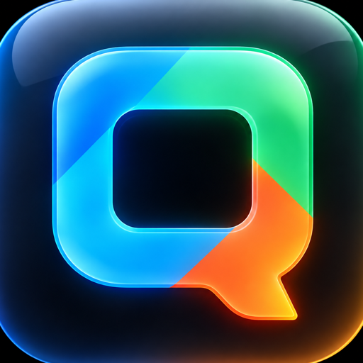

# Quegly for AI agents



Schedule, publish and measure your social media from Claude, Hermes Agent or any AI agent that speaks MCP,
with [Quegly](https://quegly.com). Ask in plain words and the agent does it through Quegly's hosted MCP
server:

- **Post everywhere at once**: Instagram, TikTok, YouTube, Facebook, X, Threads, LinkedIn, Bluesky,
  Pinterest and Telegram, from one post
- **Schedule, publish now or save drafts**, up to 90 days ahead
- **Photos, videos and carousels**, Instagram and Facebook stories, Pins, YouTube titles, video covers and a
  different caption per platform or per account
- **Fix and retry** posts that failed on one platform
- **Analytics**: views, likes, comments and shares per post and per platform

This package holds one skill (`skills/quegly`) that teaches the agent how to use the tools well and safely,
and the connection to the MCP server at `https://api.quegly.com/mcp`.

## What you need

A [Quegly](https://quegly.com) account with an active subscription, and an API key:

1. Open **Settings**, **API** (https://quegly.com/settings/api) and create a key. It starts with `qgl_`.
2. Pick **Full access (all workspaces)**, or bind the key to one workspace.

Never paste your key into a chat. It goes in your agent's settings, as shown below.

## Install

### Claude Code

```
/plugin marketplace add quegly/agent
/plugin install quegly@quegly
```

Claude Code asks for your API key when the plugin is enabled and keeps it in your system's secure storage.

### Hermes Agent

```
hermes plugins install quegly
```

Before the catalog listing is live, install from GitHub instead:

```
hermes plugins install quegly/agent --no-enable
hermes plugins enable quegly
```

Set your key in the plugin's settings in Hermes, or as `QUEGLY_API_KEY` in your Hermes profile's `.env`.
Hermes asks you before every tool call that changes something, because the package marks the server as
untrusted.

### Just the skill (any agent)

```
npx skills add quegly/agent --skill quegly
```

Then connect the MCP server yourself: URL `https://api.quegly.com/mcp` (Streamable HTTP), with your key as
the header `Authorization: Bearer <your key>`. In Claude Code:

```
claude mcp add --transport http quegly https://api.quegly.com/mcp --header "Authorization: Bearer <your key>"
```

Cursor, VS Code, Claude Desktop and other clients: see https://quegly.com/developers/mcp.

## Try it

- "Schedule these three photos to Instagram and X for Friday at 9am."
- "Post this video to TikTok and YouTube now, with the title 'Behind the scenes'."
- "What's scheduled for this week?"
- "Move every post scheduled for tomorrow to Monday at the same time."
- "What were my five most viewed posts last month?"

## What this package does, and where data goes

- Every tool call goes to Quegly's hosted server at `api.quegly.com` and acts on your Quegly account with your
  API key. The tool list is served by that server, so it can grow without a new version of this package.
- Some tools reach the public once you confirm: they publish or schedule posts to your connected social
  accounts, and delete scheduled posts, drafts and video covers.
- The skill tells the agent to confirm each of those with you first and to treat text other people wrote
  (captions, comments) as data, never as instructions.
- Your key is stored by your agent (Claude Code's secure storage or your Hermes profile). This package has no
  code of its own, runs nothing on your machine, and sends no telemetry.

## Links

- MCP docs: https://quegly.com/developers/mcp
- Everything in one file for agents: https://quegly.com/llms-full.txt
- Support: https://quegly.com/support

## License

MIT
